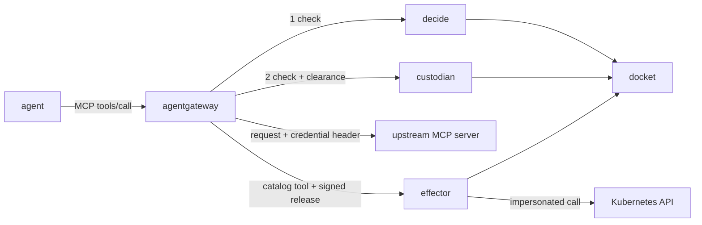

# agent-bailiff

Lets an AI agent use a credential for one approved tool call without ever holding that credential. For Kubernetes, no credential leaves agent-bailiff at all: its own effector runs each approved operation.

Status: pre-release. Interfaces and wire formats may change. Not ready for production use.

## Why

An agent that holds API keys can use them for anything, including after a prompt injection. Keeping keys in a gateway helps, but if the component that decides a call also holds the keys, one compromise of it exposes every credential.

agent-bailiff splits that job:

- Each effect is bounded to the agent's task: one call, one operation, one credential release.
- The component that decides holds no credentials. The component that holds secrets re-checks the authority itself before every decrypt, so a compromised decider cannot bulk-decrypt the store.
- Each allowed decision and each credential release needs an acknowledged, signed docket entry, joined by trace id and operation id.
- For infrastructure, the effector holds the only credential and acts as an identity the cluster limits to the approved operation class, so no MCP server or agent ever holds a token it could reuse.

## How it works



1. **decide** verifies the agent's delegation chain and its proof for this exact call, checks scope, cost, policy and suspension, reserves the operation in the ledger, and returns a signed single-use clearance. It holds no credentials.
2. **custodian** re-verifies the chain, proof and reservation on its own, applies canary checks, decrypts the credential, checks suspension, then claims the operation once under a per-task rate limit and sets the credential as a header on the upstream request. It removes every agent header except `accept`, `content-type`, `mcp-protocol-version` and the trace headers. When the result comes back, its redactor replaces any echo of that credential with a marker and records an alert.
3. **docket** is a separate process that appends a signed, hash-chained entry for each allow, release and verified refusal. Refusals before the chain verifies, and verified refusals past a per-task budget, are logged instead; passing the budget is itself recorded once (see [docs/THREAT_MODEL.md](docs/THREAT_MODEL.md)).
4. **effector** (catalog tools only, Kubernetes today) is the gateway's upstream instead of a third-party MCP server. The custodian signs a single-use release rather than releasing a credential. The effector verifies the release and decide's clearance, rebuilds the request from the operation catalog, records an attempt, and calls the API server under constrained impersonation as `bailiff:<tenant>:<identity>`. Generated RBAC and admission policies bound what that identity can do, and a drift check stops the effector if the cluster holds anything else. See [docs/EFFECTOR.md](docs/EFFECTOR.md).

Each component is meant to run as its own OS user. Decide, custodian and docket listen on Unix sockets that accept only their configured peer uids; control runs on demand as decide's uid. The ledger and the suspension directory (`<ledger>.suspension`, mode 0750) are owned by decide and shared read-only with the custodian through the ledger group. Their parent directory must be owned by root or decide, in that group, and not group or other writable.

## What it does not protect

- For credential bindings, the upstream MCP server receives the credential and is trusted. Catalog tools go to the effector instead; its limits are in [docs/EFFECTOR.md](docs/EFFECTOR.md).
- Echo redaction is best-effort suppression of literal forms in the call's own result, not a containment boundary. JSON-RPC error text, event-stream side messages, forms under 12 characters such as short Basic passwords, and transformed or split echoes are not redacted; see [docs/THREAT_MODEL.md](docs/THREAT_MODEL.md).
- Root on the host can read every component's keys.
- A completed effect is not undone.
- Suspension is checked by decide before it issues a clearance and by the custodian just before it claims a release. A release that has already passed the custodian's check completes.
- The suspension checks read mode bits, owner and group. The ledger's parent check, in agent-warrant, does not check the parent's owner. Neither inspects ACLs, and both check only the immediate parent directory.
- Revocation works on a delegation link, a task, a tenant or a task root. There is no revocation of an agent key across every chain that uses it.
- Control revokes the handles in a record signed by a pinned decide or custodian key. It checks that a tenant handle matches the record's tenant, but trusts that signer for the root and link bindings, so a compromised decide or custodian key can name any binding.
- Deployment is single host: gateway, bailiff and upstreams on one Docker host or machine. Plain `http` is allowed only to loopback or a single-label service name on that host; any hop that leaves the host must use `https://`. Multi-host needs TLS on every non-loopback hop (#86).
- agentgateway v1.7.0 cannot check client notifications. See [docs/AGENTGATEWAY.md](docs/AGENTGATEWAY.md) for this and the other adapter limits.

## Packages

| Module | Role |
|---|---|
| `agent_bailiff.decide` | Verify a call and issue a clearance |
| `agent_bailiff.custodian` | Store credentials encrypted; release one per clearance |
| `agent_bailiff.docket` | Signed, hash-chained security trace, cut into segments; `docket archive` copies sealed ones before removal |
| `agent_bailiff.adapters.agentgateway` | agentgateway `ExtMcp` processors and `check-config` |
| `agent_bailiff.effector` | Operation catalog, effector MCP server, Kubernetes client, generated RBAC and admission, drift check |
| `agent_bailiff.webhook` | Release-verifying admission webhook, drift/access audit, bounded structured security events |
| `agent_bailiff.signing` | Ed25519 signed records over canonical JSON |

Built on [agent-warrant](https://github.com/agent-rails/agent-warrant) (task roots, delegation chains, ledger) and [toolcall-authz](https://github.com/agent-rails/toolcall-authz) (policy).

## Requirements

- Python 3.13
- Linux or macOS (peer credentials on Unix sockets)
- [agentgateway](https://github.com/agentgateway/agentgateway) v1.7.0 for the gateway adapter
- For the effector: Kubernetes v1.36 or later (constrained impersonation, beta in v1.36); tested on OrbStack v1.36.5 and kind v1.36.4. On v1.34 the effector's calls are refused (28 of 36 cluster tests fail with 403 on kind v1.34.3).
- Managed clusters, reads only (`kubernetes-read` catalog, nothing from bailiff runs in the cluster), see [docs/MANAGED_CLUSTERS.md](docs/MANAGED_CLUSTERS.md):
  - GKE Standard 1.36: probed on 1.36.4-gke.2377000 on 2026-11-22; read-only effector run recorded on 2026-11-23 at d673325, later revisions not re-run on GKE. Pod logs reach the agent unfiltered.
  - EKS: not supported; not probed.
  - GKE Autopilot: not tested.

## Usage

Not yet on PyPI. To put an agent host in front of one MCP server, follow [docs/ADOPT.md](docs/ADOPT.md), which installs from a git tag; to work on agent-bailiff itself, install from source (see Development).

Check a gateway config before starting agentgateway. Run it as the custodian's user, because it reads the credential binding table:

```sh
python -m agent_bailiff.adapters.agentgateway check-config \
  --gateway-config gateway.json \
  --routes routes.json \
  --bindings bindings.json \
  --decide-socket /run/bailiff/decide/decide.sock \
  --custodian-socket /run/bailiff/custodian/custodian.sock \
  --redactor-socket /run/bailiff/custodian/redactor.sock
```

It refuses any config the processors cannot enforce, such as `failOpen`, a missing decide header allowlist, a custodian header filter, stateful mode, the wrong processor order, a missing redactor, missing or unbounded upstream timeouts or a TCP processor target.

Each component has its own commands, run as that component's uid:

- `agent-bailiff init {decide,custodian,control,docket}` creates the component's config; for decide, custodian and control it also creates the signing key. Decide starts with a deny-all policy and the custodian with no credential bindings.
- `agent-bailiff {decide,custodian,docket} run --config FILE` runs a service until SIGTERM or SIGINT.
- `agent-bailiff control revoke|suspend|resume` runs as decide's uid. `revoke` and `suspend` take one signed docket line as `--record`; `revoke` takes `--level link|task|tenant|root`.
- `agent-bailiff docket verify` checks every record on the host against pinned writer keys, and with `--archive` every record from the first; `docket archive` copies sealed segments to an archive directory on another file system and writes the receipt the sink needs before it removes one; `docket tasks` lists tasks with their counts, revocation state and a record to revoke from; `agent-bailiff docket export` (extra `otel`) sends verified records as OTLP spans, off the call path. See [docs/DOCKET.md](docs/DOCKET.md).
- Allow, release and recorded refuse entries carry `latency_ms`, the time decide or the custodian spent on the call. Measured overhead on one host is in [docs/DOCKET.md](docs/DOCKET.md#latency); rerun it with the opt-in quickstart benchmarks.

## Documentation

- [docs/ADOPT.md](docs/ADOPT.md): put one agent host in front of one MCP server: install, credential, task issue, routes, proxy, renew and revoke
- [docs/ARCHITECTURE.md](docs/ARCHITECTURE.md): components, one call end to end, data and signed records
- [docs/THREAT_MODEL.md](docs/THREAT_MODEL.md): assets, attackers, mitigations and residual risks
- [docs/DECISIONS.md](docs/DECISIONS.md): design decisions and credits
- [docs/CLIENT.md](docs/CLIENT.md): agent-side client, refusal actions, delegating to a sub-agent and route schemas
- [docs/AGENTGATEWAY.md](docs/AGENTGATEWAY.md): adapter method surface, sockets, config rules and limits
- [docs/DOCKET.md](docs/DOCKET.md): docket trust model and operations
- [docs/EFFECTOR.md](docs/EFFECTOR.md): the Kubernetes effector, its catalog, generated RBAC and admission, drift check and limits
- [docs/MANAGED_CLUSTERS.md](docs/MANAGED_CLUSTERS.md): reads on GKE and EKS, token minting, cloud IAM check and rollback
- [docs/RELEASE_WEBHOOK.md](docs/RELEASE_WEBHOOK.md): release admission, operator signals, response steps and rollout gates
- [examples/quickstart](examples/quickstart/README.md): local Docker Compose stack with Gitea, a scripted agent, optional tracing and a revoke rule
- [examples/live-run](examples/live-run/README.md): end-to-end run with Claude as the agent, and its results

## Development

```sh
python3.13 -m venv .venv
.venv/bin/python -m pip install --require-hashes -r requirements-ci.txt
.venv/bin/python -m pip install --no-deps --no-build-isolation -e .
.venv/bin/ruff check && .venv/bin/ruff format --check && .venv/bin/mypy && .venv/bin/pytest -q
```

`generate_proto.sh` checks the sha256 of the vendored agentgateway `ExtMcp` proto (`adapters/agentgateway/proto/ext_mcp.proto`, v1.7.0, commit `26f5aeb`, Apache-2.0) and generates the Python stubs into `agent_bailiff/adapters/agentgateway/_proto`. The stubs are committed so a git install works without `grpcio-tools`; run the script after changing the proto, and the test suite fails when the committed stubs differ from a fresh run.

The end-to-end tests run against the agentgateway v1.7.0 release binary. `adapters/agentgateway/scripts/fetch_gateway.sh` downloads it into `~/.cache/agent-bailiff`, checked against `adapters/agentgateway/agentgateway-v1.7.0.sha256`; without it those tests are skipped.

## License

Apache-2.0. See [LICENSE](LICENSE).
