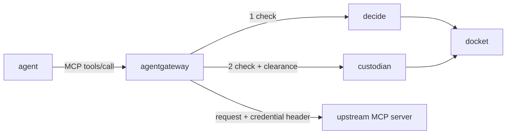

# agent-bailiff

Lets an AI agent use a credential for one approved tool call without ever holding that credential.

Status: pre-release. Interfaces and wire formats may change. Not ready for production use.

## Why

An agent that holds API keys can use them for anything, including after a prompt injection. Keeping keys in a gateway helps, but if the component that decides a call also holds the keys, one compromise of it exposes every credential.

agent-bailiff splits that job:

- Each effect is bounded to the agent's task: one call, one operation, one credential release.
- The component that decides holds no secrets. The component that holds secrets re-checks the authority itself before every decrypt, so a compromised decider cannot bulk-decrypt the store.
- Every decision and release is signed into one trace you can follow end to end.

## How it works



1. **decide** verifies the agent's delegation chain and its proof for this exact call, checks scope, cost, policy and suspension, reserves the operation in the ledger, and returns a signed single-use clearance. It holds no secrets.
2. **custodian** re-verifies the chain, proof and reservation on its own, claims the operation once, applies a per-task rate limit and canary checks, then decrypts the credential and sets it as a header on the upstream request. It removes any credential the agent sent.
3. **docket** is a separate process that appends a signed, hash-chained entry for each decision and release.

Each component runs as its own OS user and listens on a Unix socket that accepts only its expected peer.

## What it does not protect

- The upstream MCP server receives the credential and is trusted.
- Root on the host can read every component's keys.
- A completed effect is not undone; revocation stops later calls only.
- agentgateway v1.7.0 cannot check client notifications. See [docs/AGENTGATEWAY.md](docs/AGENTGATEWAY.md) for this and the other adapter limits.

## Packages

| Module | Role |
|---|---|
| `agent_bailiff.decide` | Verify a call and issue a clearance |
| `agent_bailiff.custodian` | Store credentials encrypted; release one per clearance |
| `agent_bailiff.docket` | Signed, append-only security trace |
| `agent_bailiff.adapters.agentgateway` | agentgateway `ExtMcp` processors and `check-config` |
| `agent_bailiff.signing` | Ed25519 signed records over canonical JSON |

Built on [agent-warrant](https://github.com/agent-rails/agent-warrant) (task roots, delegation chains, ledger) and [toolcall-authz](https://github.com/agent-rails/toolcall-authz) (policy).

## Requirements

- Python 3.13
- Linux or macOS (peer credentials on Unix sockets)
- [agentgateway](https://github.com/agentgateway/agentgateway) v1.7.0 for the gateway adapter

## Usage

Not yet on PyPI; install from source (see Development).

Check a gateway config before starting agentgateway. Run it as the custodian's user, because it reads the credential binding table:

```sh
python -m agent_bailiff.adapters.agentgateway check-config \
  --gateway-config gateway.json \
  --routes routes.json \
  --bindings bindings.json \
  --decide-socket /run/bailiff/decide/decide.sock \
  --custodian-socket /run/bailiff/custodian/custodian.sock
```

It refuses any config the processors cannot enforce, such as `failOpen`, a missing header allowlist, the wrong processor order or a TCP processor target.

## Documentation

- [docs/AGENTGATEWAY.md](docs/AGENTGATEWAY.md): adapter method surface, sockets, config rules and limits
- [docs/DOCKET.md](docs/DOCKET.md): docket trust model and operations

## Development

```sh
python3.13 -m venv .venv
.venv/bin/python -m pip install --require-hashes -r requirements-ci.txt
.venv/bin/python -m pip install --no-deps --no-build-isolation -e .
PYTHON=.venv/bin/python sh adapters/agentgateway/scripts/fetch_proto.sh
.venv/bin/ruff check && .venv/bin/ruff format --check && .venv/bin/mypy && .venv/bin/pytest -q
```

`fetch_proto.sh` downloads the agentgateway `ExtMcp` proto (v1.7.0, commit `26f5aeb`), checks its sha256 and generates the Python stubs; they are not committed.

The end-to-end tests run against the agentgateway v1.7.0 release binary. `adapters/agentgateway/scripts/fetch_gateway.sh` downloads it into `~/.cache/agent-bailiff`, checked against `adapters/agentgateway/agentgateway-v1.7.0.sha256`; without it those tests are skipped.

## Acknowledgements

The custodian design draws on the IETF CB4A draft and Solo.io's agentgateway blog series on credential brokering.

## License

Apache-2.0. See [LICENSE](LICENSE).
