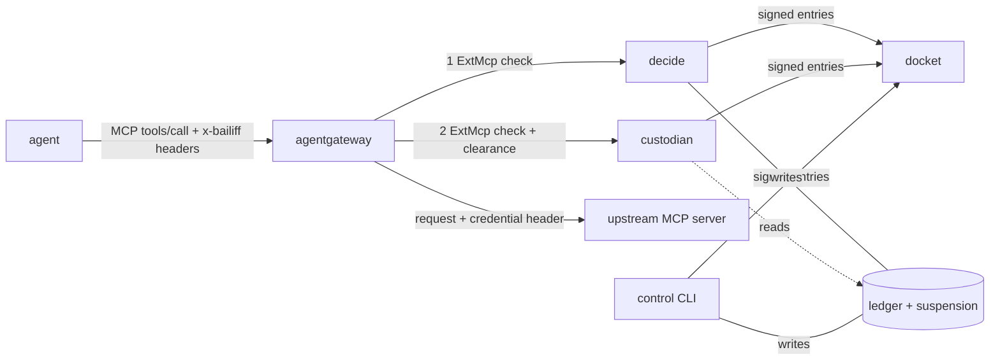

# Architecture

agent-bailiff lets an agent use a credential for one approved tool call without holding it. It runs as separate processes behind a gateway. The first and only gateway adapter is agentgateway v1.7.0.

## Components

| Component | Runs as | Holds | Listens on |
|---|---|---|---|
| decide | its own uid; owns the ledger | its signing key, policy, cost table, routes, the ledger (writer), the suspension switch | Unix socket for the gateway (ExtMcp) |
| custodian | its own uid; in the ledger group | its signing key, key encryption key, credential store, binding table, claims database, routes; the ledger and suspension state read-only | Unix socket for the gateway (ExtMcp) |
| docket | its own uid | the docket file, pinned writer keys | Unix socket for decide, custodian and control |
| control | decide's uid, run on demand | its signing key; decide's config | none (CLI) |
| agentgateway | its own uid | gateway config | the agent's MCP connection |

No component holds another component's private key. Each verifier pins the peer public keys it accepts by key id in config it owns.

## One tool call

1. The agent sends `tools/call` with its task root, delegation links, a leaf proof for this exact call and a nonce in `x-bailiff-*` headers.
2. agentgateway calls decide's processor. Decide:
   - maps the gateway service and tool name to a tool id and resource through its routes;
   - verifies the delegation chain and leaf proof with agent-warrant;
   - checks scope, cost (from decide's cost table, never the agent), policy and suspension;
   - reserves the operation in the ledger and marks it issued;
   - writes a signed docket entry and waits for the sink's acknowledgement;
   - signs a clearance (`agent-bailiff/clearance/v1`) for this operation and returns it as gateway metadata.

   A refusal at any step returns an error and no clearance.
3. agentgateway calls the custodian's processor with the clearance. The custodian:
   - verifies the clearance signature and audience;
   - re-verifies the chain and leaf proof from the call itself, and checks the recomputed digests against the clearance;
   - checks that the ledger reservation for the op_id is issued and not revoked;
   - looks up the credential binding from its own table;
   - applies canary checks, decrypts the credential, and checks suspension;
   - claims the op_id once under a per-task rate limit;
   - writes a signed docket entry and waits for the acknowledgement;
   - sets the credential as a header on the upstream request.

   It also removes the agent's own `authorization`, `proxy-authorization` and `cookie` headers and the `x-bailiff-*` headers.
4. The upstream MCP server receives the call with the credential header.

Every hop records its entry under the same trace id and op_id, so the decide and custodian entries for one call can be joined.

## Data

- **Ledger:** agent-warrant's `TaskLedger` (SQLite). Decide is the only writer; the custodian opens it read-only through the shared group. It holds reservations, issued and outcome state, and revocations (binding, task, tenant).
- **Suspension:** `<ledger>.suspension`, a directory owned by decide, group the ledger group, mode 0750. A `suspended` file in it means suspended. Decide and the custodian both treat anything they cannot verify as suspended.
- **Credential store:** SQLite, custodian-only, mode 0600. Each credential is encrypted with AES-GCM under its own data key; the data key is wrapped by the key encryption key. Both use the associated data `{tenant, credential_id, target}`.
- **Claims:** SQLite, custodian-only. The op_id is the primary key, so a second release of the same operation fails. Task denies from canary hits are stored here.
- **Docket:** one append-only file of signed records with per-writer sequence and hash chains. See [DOCKET.md](DOCKET.md).

## Signed records

All records are Ed25519 signatures over agent-warrant's canonical JSON, encoded as `b64url(payload).b64url(signature)`. The payload carries `typ`, `v` and `kid`. Decoding is strict: unknown fields and a wrong `typ` are refused.

- Clearance: `typ, v, kid, iss, aud, iat, exp, op_id, tenant, task, root_binding, leaf_binding, request_digest, tool, resource, args_digest, cost, credential_id, target, trace_id, entry_id`. Its lifetime is at most the custodian's `max_clearance_lifetime`, which is at most `max_proof_age`.
- Docket entry (`agent-bailiff/docket-entry/v1`): who (principal, tenant, task root, links, agent key), what (tool, resource, args digest, cost), policy (id, version, digest, rule, verdict), what was done (performed, outcome, credential tier), how (hop, component, decision, reason), and revocable handles.

## Control

`agent-bailiff control` runs as decide's uid against decide's config.

- `revoke` takes one signed docket line, verifies it against pinned writer keys, and revokes its handle at the chosen level (`link`, `task`, `tenant`, `root`) in the ledger.
- `suspend` and `resume` set or clear the suspension switch.

Each action is applied first and then recorded as a control entry in the source record's trace. An unacknowledged entry is reported as unrecorded.

## Failure behaviour

Every component fails closed:
- An error refuses the call.
- No clearance or credential is returned on an error path.
- A docket write that is not acknowledged refuses the call.
- check-config refuses a gateway config with `failOpen`, a missing header allowlist, the wrong processor order or a non-Unix processor target.

## Credential tiers

The docket records a credential tier for each release. Only `gateway-bound` is implemented: the credential is long-lived and never reaches the agent, and the operation binding holds only at this layer. `target-bound` credentials, narrowed or minted per operation at the target, and other key backends are not built yet.
